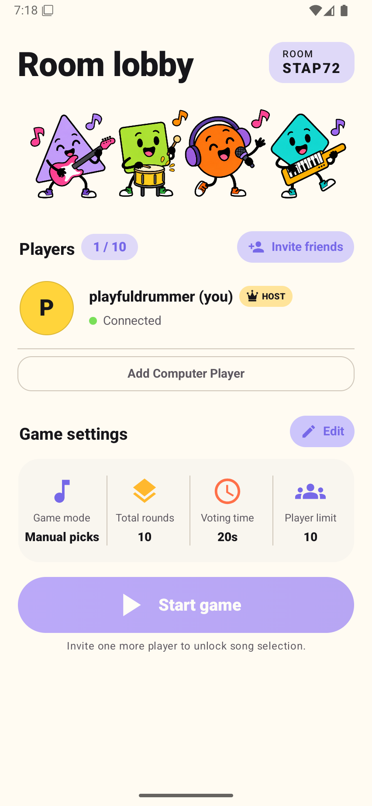
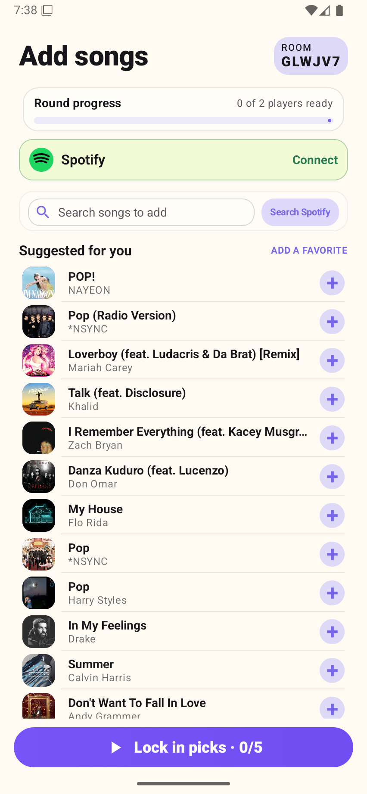
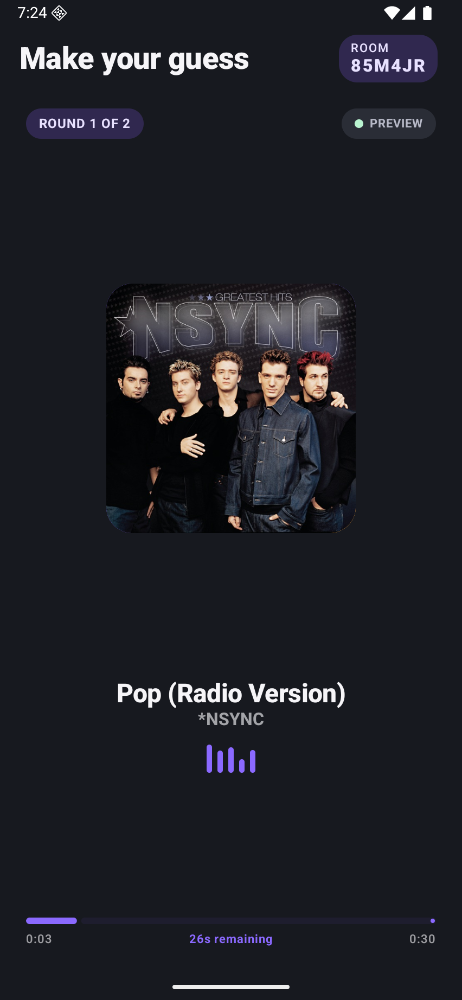
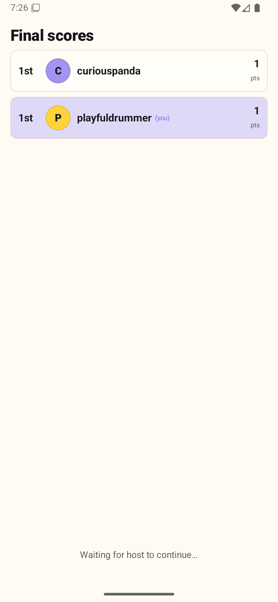
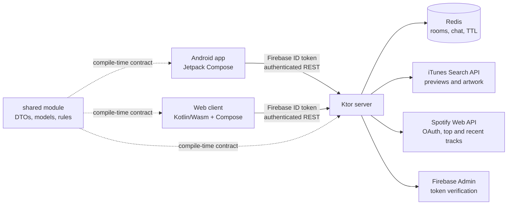

# Guess Whose Song

A multiplayer party quiz app. Players submit songs anonymously. Everyone votes on who submitted each clip. Correct guesses earn points.

**[⬇️ Download the Android APK](artifacts/GuessWhoseSong.apk)**

## Screenshots

The checked-in captures below show the Android flow in both themes.

| Lobby | Song selection | Voting | Results |
| --- | --- | --- | --- |
|  |  |  |  |

Dark-theme references: [dark lobby](reports/android-ui-audit-2026-10-18/after/gws-dark-lobby-final.png), [dark song selection](reports/android-ui-audit-2026-10-18/after/add-songs-dark.png), and [dark results](reports/android-ui-audit-2026-10-18/after/dark-results.png). The complete paired gallery is in [the Android UI audit](reports/android-ui-audit-2026-10-18/REPORT.md).

## System design



The server is authoritative. Clients render the state they receive and send actions; they do not decide scores, ownership, timers, decoy eligibility, or the final song pool.

## Project Structure

```
MusicAppProject/
├── shared/   # Kotlin Multiplatform — DTOs shared between server and Android
├── server/   # Ktor backend (game engine, Redis, iTunes/Spotify/Firebase)
├── app/      # Android client (Jetpack Compose)
├── web/      # Kotlin/Wasm Compose browser client (Firebase Hosting)
└── artifacts/ # APKs intended for manual download or GitHub Releases
```

### Why `shared/` matters

`shared/` is the protocol boundary. It prevents the Android client, browser client, and server from disagreeing about JSON or game state.

- `models/Models.kt` defines `Room`, `Player`, `SongEntry`, `RoomSettings`, avatar data, score data, and song metadata.
- `models/Enums.kt` defines room states, round phases, game modes, voting timers, and round-count rules.
- `dto/ClientMessages.kt` defines actions such as `START_GAME`, `LOCK_SONG`, `CAST_VOTE`, `SKIP_PREVIEW`, `PLAY_AGAIN`, `END_ROOM`, and settings updates.
- `dto/ServerMessages.kt` defines snapshots and events such as `ROOM_JOINED`, `ROOM_UPDATED`, `ROUND_PREVIEW_STARTED`, `VOTING_STARTED`, `ROUND_REVEALED`, `GAME_RESULTS`, and `ROOM_ENDED`.
- `MessageSerializer.kt` keeps the discriminator format consistent across JVM and Wasm.

The server uses these same types for validation and serialization, so a protocol change is visible to all clients at compile time.

## Setup

### 1. Firebase
- Create a Firebase project at https://console.firebase.google.com
- Enable **Anonymous Authentication**
- Enable **Google** sign-in. Guests may link Google later; linking preserves the anonymous UID and a collision is rejected (accounts are never merged automatically).
- Enable **Firebase Cloud Messaging**
- Enable **Crashlytics** and **Analytics**
- Download `google-services.json` and replace `app/google-services.json`
- For the server: provide the service-account JSON through the deployment secret `FIREBASE_SERVICE_ACCOUNT_JSON`. A local file path is supported only for local development; never copy credentials into Docker or commit them.

### 2. Spotify (Optional — for Top Tracks and Recently Played modes)
- Create an app at https://developer.spotify.com/dashboard
- Set the redirect URI to your server URL + `/spotify/callback`
- Set env vars: `SPOTIFY_CLIENT_ID`, `SPOTIFY_CLIENT_SECRET`, `SPOTIFY_REDIRECT_URI`

### 3. Redis
- Local: `redis-server` (default port 6379)
- Production: set `REDIS_URL` env var (including `rediss://` for TLS where required, e.g. Render Redis add-on URL)

### 4. Server

The production API is hosted at `https://guess-whose-song-server.onrender.com`.
Spotify's registered server callback must be
`https://guess-whose-song-server.onrender.com/spotify/callback`.

```bash
./gradlew :server:shadowJar
java -jar server/build/libs/guess-whose-song-server.jar
```

Run only one Ktor server on port 8080. If it is already running in another terminal or tmux pane, reuse it; stop that process before starting another instance, or the second start will fail with `Address already in use`. The ngrok tunnel can remain running while the server is restarted.

### 5. Android
- Open in Android Studio
- Set the `gwsApiBaseUrl` Gradle property to point to your server; it defaults to `https://guess-whose-song-server.onrender.com`
- Run on device or emulator

### 6. Web

The browser client uses Kotlin/Wasm and Compose Multiplatform. It signs users in anonymously through Firebase, then optionally links Google without changing the Firebase UID. Copy `web/firebase-config.example.js` to `web/src/wasmJsMain/resources/firebase-config.local.js`, fill in the public Firebase web configuration and API origin, and copy it over `web/src/wasmJsMain/resources/firebase-config.js` for a local build.

```bash
./gradlew :web:wasmJsBrowserDevelopmentRun
```

For Firebase Hosting:

1. Enable Anonymous and Google providers in Firebase Authentication.
2. Add the Firebase Hosting domain to Authentication authorized domains.
3. Copy `.firebaserc.example` to `.firebaserc` and set the Firebase project ID.
4. Set the production values in `web/src/wasmJsMain/resources/firebase-config.js` or inject the public config during CI.
5. Build and deploy:

```bash
./gradlew :web:wasmJsBrowserDistribution
firebase deploy --only hosting
```

The hosting output is `web/build/dist/wasmJs/productionExecutable`. Room connections use a six-character code and display name. Clients authenticate room joins, actions, and event polling with a Firebase bearer token; room credentials and display names are never placed in the URL. The event endpoint holds each request for up to 20 seconds and returns any queued room events.

CI can inject the complete public `firebase-config.js` contents through the `WEB_FIREBASE_CONFIG` repository secret. Firebase web configuration is client-visible; Firebase Admin service-account credentials must never be placed in this file or any browser bundle.

## Environment Variables (Server)

| Variable | Description |
|---|---|
| `PORT` | HTTP port (default 8080) |
| `FIREBASE_PROJECT_ID` | Firebase project ID used to verify browser ID tokens (default `guess-whose-song`) |
| `REDIS_URL` | Redis connection URL |
| `FIREBASE_SERVICE_ACCOUNT_JSON` | Firebase Admin service-account JSON deployment secret |
| `FIREBASE_SERVICE_ACCOUNT_PATH` | Local-only fallback path; do not use in container images |
| `SPOTIFY_CLIENT_ID` | Spotify app Client ID |
| `SPOTIFY_CLIENT_SECRET` | Spotify app Client Secret |
| `SPOTIFY_REDIRECT_URI` | Spotify OAuth redirect URI |
| `SPOTIFY_WEB_REDIRECT_URI` | Fixed web URL returned after Spotify OAuth; never accept arbitrary redirect targets |
| `WEB_ORIGINS` | Optional comma-separated additional browser origins; Firebase Hosting and localhost development origins are allowed by default |

## Architecture

- **Transport**: Authenticated Ktor REST actions with long-poll room events
- **State**: Redis (ephemeral, TTL-based cleanup)
- **Music and artwork**: iTunes Search API (preview clips and album artwork)
- **Identity**: Firebase Anonymous Auth
- **Recovery**: optional Google account linking through Firebase Auth
- **Notifications**: Firebase Cloud Messaging
- **Web**: Kotlin/Wasm + Compose Multiplatform, hosted by Firebase Hosting

### Game flow

1. A client signs in anonymously with Firebase and obtains a Firebase ID token.
2. `POST /rooms` creates a room using the verified Firebase UID as the host identity.
3. Other players join with the six-character code through `POST /rooms/{code}/join`.
4. Clients poll `GET /rooms/{code}/events`; the server long-polls for up to 20 seconds and returns queued events.
5. The host starts the game. Players choose songs in manual mode, or the server obtains Spotify tracks in one of the automatic modes.
6. The server resolves playable entries through iTunes, builds the round pool, and broadcasts preview, voting, reveal, and score events.
7. After the configured rounds, `GAME_RESULTS` is sent. The host can play again or end the room.

Rooms, runtime state, rate-limit counters, OAuth state, and chat history are stored in Redis. Chat remains available for the life of the room and is deleted when the room is ended or its TTL expires.

### Song-pool rules

Manual mode requires every human player to contribute at least one playable song. The server resolves title and artist through iTunes and uses iTunes preview URLs and artwork. Two-player rooms receive genre-matched `Nobody / Decoy` tracks; rooms with three or more players do not add a decoy.

For **Recently Played** and **Top Tracks**, each connected player contributes Spotify tracks. A Spotify track enters the playable pool only when iTunes has a match with the same normalized title, artist, and album. Tracks without a usable iTunes preview are skipped, and duplicate recordings or ambiguous ownership are removed before the round pool is built. Two-player Spotify games also receive genre-matched decoys.

The shared rules cap rooms at 10 players and 30 rounds. A two-player game requires at least three rounds so both player songs and a decoy can be represented. Voting timers are 10, 15, 20, or 30 seconds. `RoundPoolBuilder`, `RecentPlayedPoolBuilder`, and `RecentTrackDeduplicator` enforce these rules on the server.

### Backend responsibilities

- `Application.kt` starts Ktor, Redis, authentication, serialization, CORS, status handling, and shutdown hooks.
- `RoomManager` owns room creation, lookup, cleanup, host reassignment, and room TTL behavior.
- `RoomSession` is the authoritative state machine for lobby, submission, playing, results, chat, votes, timers, and room end.
- `RoomRepository`, `RoomRuntimeRepository`, and `RoomChatRepository` persist Redis-backed state.
- `MusicService` limits external requests, caches catalog searches, resolves Spotify metadata through iTunes, and selects genre-matched tracks.
- `ItunesClient` is the source for playable previews and artwork.
- `SpotifyOAuth` and `SpotifyClient` handle PKCE, token exchange, top tracks, recent tracks, and playlist reads.
- `FirebaseTokenVerifier` validates Firebase ID tokens before room, music, Spotify, and crash-log operations.
- `RateLimiter` protects room creation, actions, polling, search, Spotify calls, and chat.

## API surface

All routes below require `Authorization: Bearer <Firebase ID token>` unless marked public. The server verifies the token and uses its Firebase UID as the player identity.

| Method | Route | Purpose |
| --- | --- | --- |
| `GET` | `/` | Deployment/root response |
| `GET` | `/health` | Render health check and wake-up probe; public |
| `POST` | `/rooms` | Create a room |
| `GET` | `/rooms/{code}` | Read room summary |
| `POST` | `/rooms/{code}/join` | Join or reconnect a player |
| `DELETE` | `/rooms/{code}/join` | Leave a room |
| `GET` | `/rooms/{code}/events` | Long-poll room events |
| `GET` | `/rooms/{code}/chat` | Read room chat history |
| `POST` | `/rooms/{code}/chat` | Send a room chat message |
| `POST` | `/rooms/{code}/actions` | Send a shared `ClientMessage` action |
| `GET` | `/music/search?q=...` | Search iTunes through the server proxy |
| `GET` | `/music/top` | Get catalog suggestions |
| `GET` | `/spotify/auth-url?client=android\|web` | Start Spotify OAuth with server-side PKCE |
| `GET` | `/spotify/callback` | Complete Spotify OAuth |
| `GET` | `/spotify/status` | Check the current user's Spotify connection |
| `DELETE` | `/spotify/connection` | Remove the current user's Spotify token |
| `GET` | `/spotify/top` | Read the current user's top tracks |
| `GET` | `/spotify/recent` | Read the current user's recently played tracks |
| `GET` | `/spotify/playlists/{id}/tracks` | Read tracks from a Spotify playlist |
| `POST` | `/api/logs/crash` | Submit a bounded authenticated client crash report |

The Android and web clients call the same room and music routes. Spotify access tokens are kept server-side in Redis; they are never placed in a client bundle or room URL.

## Security and deployment notes

- All room, music, Spotify, and crash-log operations require a Firebase ID token. The server uses the verified Firebase UID; legacy client-generated player IDs are not accepted.
- Room sessions use `POST /rooms/{joinCode}/join`, `POST /rooms/{joinCode}/actions`, and authenticated long polling at `GET /rooms/{joinCode}/events`. Clients leave with `DELETE /rooms/{joinCode}/join`.
- Spotify OAuth state and PKCE verifier are generated and stored server-side in Redis for ten minutes and are single-use. Android refreshes authenticated status after the deep-link callback.
- Room state uses the `gws:v2` Redis namespace for the Firebase hard cutover. The deployment is intentionally single-instance until distributed room ownership/pub-sub is implemented.
- See [SECURITY_ROTATION.md](SECURITY_ROTATION.md) for the required credential revocation and Git-history cleanup procedure.

## Render deployment

`render.yaml` defines a single Ktor web service and a private Redis service. The service uses `Dockerfile`, exposes port 8080, and checks `/health`. Render's free service can sleep when idle; the app's health probe can wake it before room creation, but the first request may still take time while the instance starts.

Required Render secrets are:

| Variable | Use |
| --- | --- |
| `FIREBASE_SERVICE_ACCOUNT_JSON` | Firebase Admin credentials; deployment secret only |
| `REDIS_URL` | Render Redis connection string |
| `SPOTIFY_CLIENT_ID` / `SPOTIFY_CLIENT_SECRET` | Spotify OAuth |
| `SPOTIFY_REDIRECT_URI` | Server callback URL |
| `SPOTIFY_WEB_REDIRECT_URI` | Browser callback destination |
| `WEB_ORIGINS` | Additional allowed browser origins |

The deployment intentionally uses one server instance because room ownership is local to the instance. Distributed room ownership and Redis pub/sub would be needed before scaling horizontally.

## CI and artifacts

GitHub Actions is defined in `.github/workflows/security.yml`. It now:

- injects the optional public web Firebase config;
- compiles shared code and runs server tests;
- builds the server fat JAR;
- assembles the Android debug APK;
- builds the production Wasm distribution; and
- uploads `app/build/outputs/apk/debug/app-debug.apk` as a workflow artifact.

CodeQL compiles the server with `SERVER_ONLY=true`, which avoids configuring Android and Wasm modules during backend analysis.

To run the same core checks locally:

```bash
./gradlew :shared:compileKotlinJvm \
  :server:test \
  :server:shadowJar \
  :app:assembleDebug \
  :web:wasmJsBrowserDistribution \
  --no-daemon --stacktrace
```

## APK distribution and signing

The current APK is stored at [`artifacts/GuessWhoseSong.apk`](artifacts/GuessWhoseSong.apk) and can also be uploaded as a GitHub Release asset. Keep keystores, passwords, `google-services.json`, Firebase Admin JSON, Spotify secrets, and Redis credentials out of the repository.

For a production release, use Android Studio's **Build → Generate Signed Bundle / APK** with the release keystore. Back up the keystore because all future updates must use the same signing key. Register the release SHA-1 and SHA-256 fingerprints in Firebase for Google authentication. For Play Store builds, also register the Play App Signing certificate fingerprints.

## Cautions and provider limits

- The iTunes Search API supplies the preview URLs and artwork. Treat its use as non-commercial in this project; obtain permission or replace the provider before a commercial launch.
- The current Spotify developer setup is intended for a maximum of five allowlisted users. Spotify-backed features also require each tester to have Spotify Premium. Confirm Spotify's current developer and product terms before expanding access.
- Spotify tokens are user-specific and expire. The server stores them in Redis and removes them when authorization expires or the user disconnects.
- Firebase web configuration is public by design. Firebase Admin credentials are private and must stay in deployment secrets.
- Rooms and chat are ephemeral. Ending a room deletes its Redis state and chat; inactivity cleanup also removes them after their TTL.

## License

This project is licensed under the GNU Affero General Public License v3.0 or later (AGPL-3.0-or-later). See [LICENSE](LICENSE) for the complete terms.
